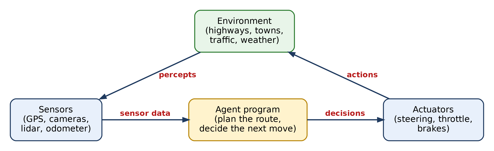
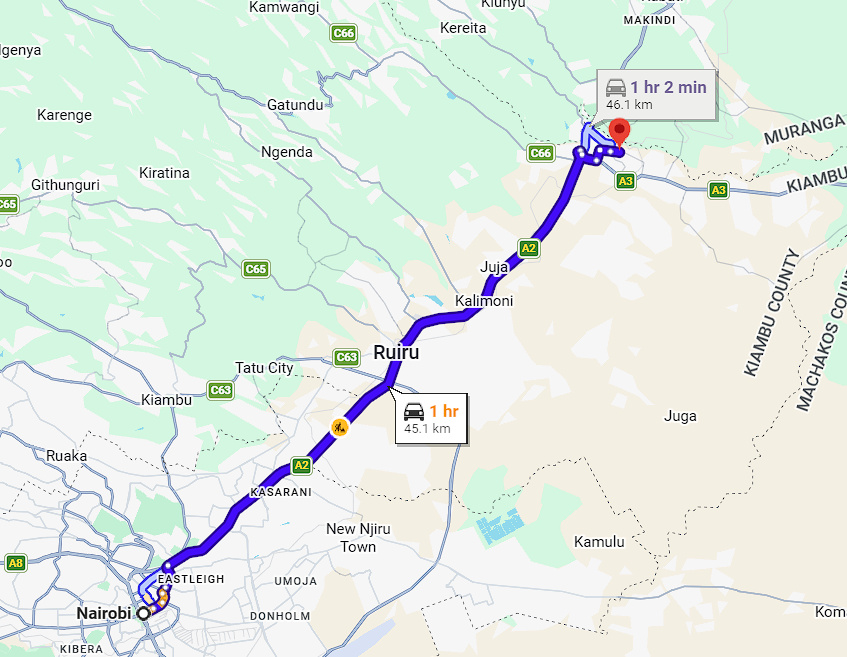
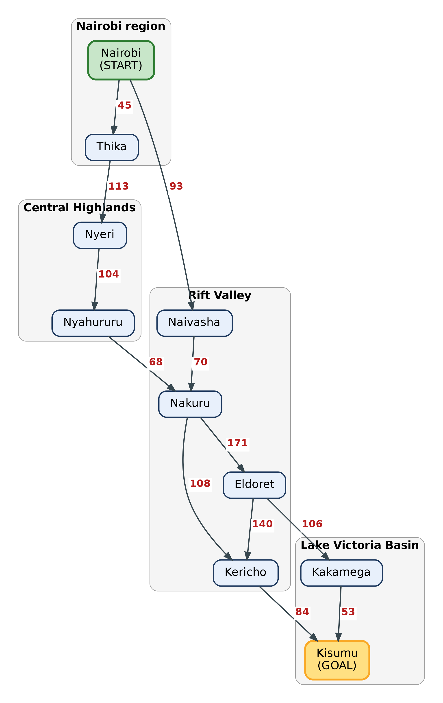
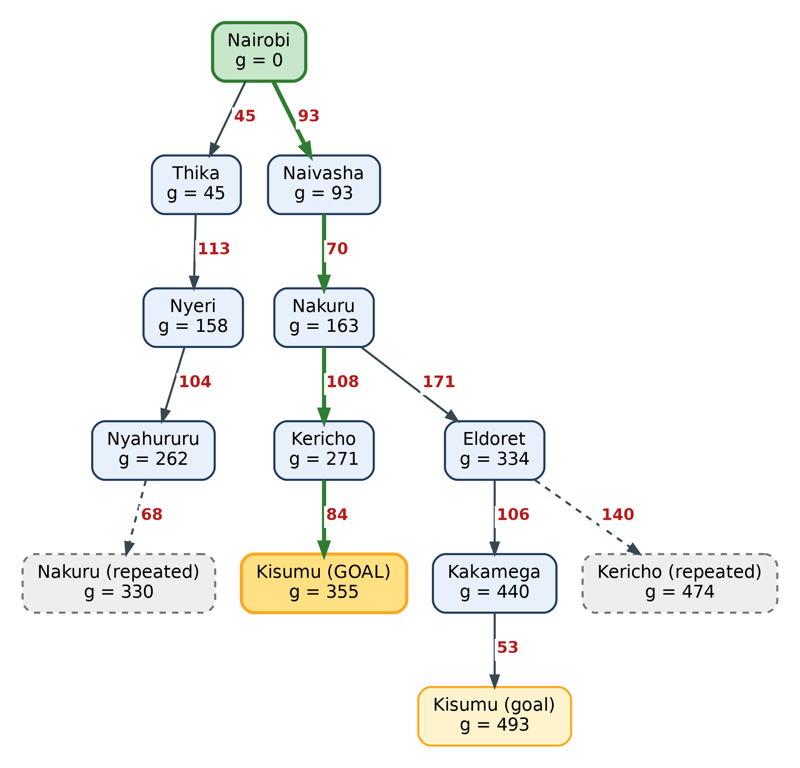
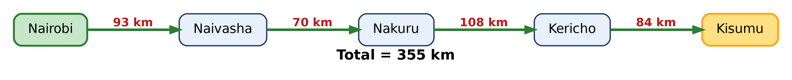
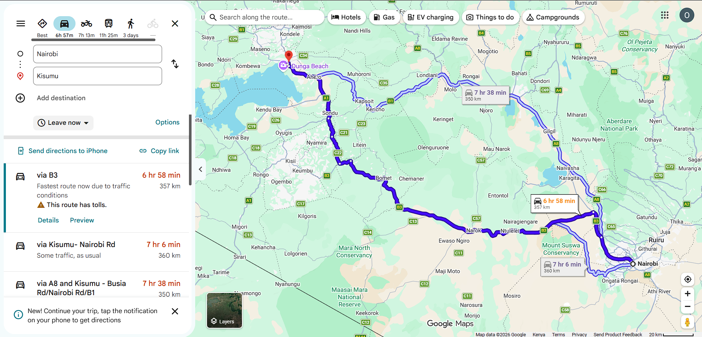

# ICS 3202: Artificial Intelligence
## Practical Exercise 3: Designing a Searching Agent

**Agent:** Self-driving trailer on Kenya's highway network
**Course:** ICS 3202 Artificial Intelligence, Strathmore University
**Date:** 15 October 2026

**Group members**

| # | Name | Reg. No. |
|---|------|----------|
| 1 | Oscar Haggai Tanui | 190481 |
| 2 | Trevor Yano | 180821 |
| 3 | David Mungai | 191392 |

---

## Contents

1. [Designing the agent with PEAS](#1-designing-the-agent-with-peas)
2. [Defining the environment](#2-defining-the-environment)
3. [Graph and search tree of the highway network](#3-graph-and-search-tree-of-the-highway-network)
4. [Optimal path from Nairobi to Kisumu](#4-optimal-path-from-nairobi-to-kisumu)
5. [Evidence of groupwork](#5-evidence-of-groupwork)

---

## 1. Designing the agent with PEAS

Our agent is a driverless trailer. Its job is to haul cargo from one Kenyan town to another, and the question we care about most here is which roads it should take. Before building anything, we describe the agent using the PEAS framework: Performance measure, Environment, Actuators and Sensors.

| PEAS element | Description for the self-driving trailer |
|---|---|
| **Performance measure** | Reaching the destination town. Keeping the total distance travelled as short as possible. Short delivery time. Low fuel use. Safe driving with no collisions. Following traffic rules and speed limits. Delivering the cargo undamaged. |
| **Environment** | Highways and roads linking towns, junctions and roundabouts, towns along the way, other vehicles (cars, matatus, buses, lorries, motorbikes), pedestrians and animals, weather (rain, fog), road surface and traffic conditions. |
| **Actuators** | Steering, accelerator, brakes, gear control, indicators, headlights, horn, and a navigation display to show the chosen route. |
| **Sensors** | GPS, digital road map, cameras, lidar and radar, ultrasonic proximity sensors, speedometer, odometer, fuel gauge, and weather and road condition sensors. |

The agent works in a repeating cycle. It reads its sensors, works out where it is and which town it should head for next, then acts on the road. Repeat until it arrives.

---

## 2. Defining the environment

We classify the trailer's environment using the five standard definitions of agent environments.

| # | Property | Classification | Reason |
|---|---|---|---|
| 1 | **Observable?** (fully vs partially) | **Partially observable** | The trailer's sensors only reach so far. It cannot see a crash, a roadblock or a flooded section beyond the next bend, and it cannot see what other drivers intend to do. |
| 2 | **Agents** (single vs multi-agent) | **Multi-agent** | Many other drivers share the road. They cooperate when they follow the rules and compete for space when they overtake or merge. |
| 3 | **Deterministic or stochastic?** | **Stochastic** | The same action does not always lead to the same result. Braking on a wet road, a sudden jam, or a tyre burst all add uncertainty. |
| 4 | **Episodic or sequential?** | **Sequential** | Each decision affects the next ones. Choosing the Nakuru road at Naivasha rules out other options and changes the fuel, time and distance left for the trip. |
| 5 | **Static or dynamic?** | **Dynamic** | The world keeps changing while the agent thinks. Traffic, weather and road conditions change from minute to minute. |

Two extra notes. The environment is also **continuous** in how it senses and acts (positions, speeds and steering angles take any value), and it is **known**, because the agent has the road map and knows the rules of driving.

**What changes for route planning.** To pick a route between towns, we deliberately treat the environment as a simpler one: fully observable, single-agent, deterministic, static and discrete. The map is known, the towns are separate points, and we assume the distances stay fixed while we plan. This simplification is the abstraction we apply in the next section. Low-level driving (staying in lane, braking for a pedestrian) would still handle the messy, stochastic and dynamic reality.

---

## 3. Graph and search tree of the highway network

### 3.1 Abstraction

A real road network has thousands of junctions, bends, side roads and estates. Searching over all of that to plan a trip between towns would be slow and pointless. So we apply abstraction and keep only what matters for choosing a route.

**What we kept**
- One node per major town on the main highways in four regions: Nairobi, Central Highlands, Rift Valley, and the Lake Victoria Basin.
- One edge per main highway link between two neighbouring towns, labelled with its road distance in km.

**What we left out**
- Minor roads, estates, individual junctions, roundabouts and bends.
- Lane details, speed limits, tolls, traffic and road quality.
- Small towns that sit along a link without changing the choice of route.

Each real stretch of highway is therefore squeezed into a single number (its distance), and each town into a single point. The agent plans over this small graph, then hands the detailed driving to its low-level controls.

**Why the graph is directed.** Real highways run both ways. Since the trailer is travelling from Nairobi towards Kisumu, we draw edges only in the direction of travel, which is Nairobi towards Lake Victoria. Reverse edges are left out because a sensible route never needs to drive back to a town it already passed.

### 3.2 Towns used

| Region | Towns |
|---|---|
| Nairobi region | Nairobi, Thika |
| Central Highlands | Nyeri, Nyahururu |
| Rift Valley | Naivasha, Nakuru, Eldoret, Kericho |
| Lake Victoria Basin | Kakamega, Kisumu |

### 3.3 Road distances (path cost)

Road distances in kilometres, taken from Google Maps search and rounded to the nearest km.

| From | To | Distance (km) |
|---|---|---|
| Nairobi | Thika | 45 |
| Nairobi | Naivasha | 93 |
| Thika | Nyeri | 113 |
| Nyeri | Nyahururu | 104 |
| Nyahururu | Nakuru | 68 |
| Naivasha | Nakuru | 70 |
| Nakuru | Kericho | 108 |
| Nakuru | Eldoret | 171 |
| Eldoret | Kericho | 140 |
| Eldoret | Kakamega | 106 |
| Kericho | Kisumu | 84 |
| Kakamega | Kisumu | 53 |

Example of how we read each distance: the Google Maps route from Nairobi to Thika is 45.1 km on the A2, which we rounded to 45 km.

### 3.4 Directed graph

Edge labels show the road distance in km. Green is the start town and gold is the goal.

### 3.5 Search tree

The search tree starts at Nairobi (the root) and unfolds every possible route. A town can show up more than once, because the tree records each different way of reaching it. Each node shows the town and **g**, the total distance travelled from Nairobi along that path.

Grey dashed nodes are **repeated states**: the town was already reached by a cheaper path, so the agent drops that branch and does not expand it. The gold node is the best goal found, and the thick green path is the cheapest route to it.

---

## 4. Optimal path from Nairobi to Kisumu

### 4.1 Problem formulation

| Element | Definition |
|---|---|
| **Initial state** | The trailer is in Nairobi |
| **Actions** | Drive along a highway to a neighbouring town |
| **Transition model** | Driving from town A to town B along a link puts the trailer in town B |
| **Goal test** | The trailer is in Kisumu |
| **Path cost** | Total road distance in km (the sum of the edge distances along the route) |

### 4.2 All possible routes

With distance as the path cost, we add up the edges of every route from Nairobi to Kisumu.

| Route | Path | Calculation (km) | Total (km) |
|---|---|---|---|
| 1 | Nairobi → Naivasha → Nakuru → Kericho → Kisumu | 93 + 70 + 108 + 84 | **355** |
| 2 | Nairobi → Naivasha → Nakuru → Eldoret → Kakamega → Kisumu | 93 + 70 + 171 + 106 + 53 | 493 |
| 3 | Nairobi → Naivasha → Nakuru → Eldoret → Kericho → Kisumu | 93 + 70 + 171 + 140 + 84 | 558 |
| 4 | Nairobi → Thika → Nyeri → Nyahururu → Nakuru → Kericho → Kisumu | 45 + 113 + 104 + 68 + 108 + 84 | 522 |
| 5 | Nairobi → Thika → Nyeri → Nyahururu → Nakuru → Eldoret → Kakamega → Kisumu | 45 + 113 + 104 + 68 + 171 + 106 + 53 | 660 |
| 6 | Nairobi → Thika → Nyeri → Nyahururu → Nakuru → Eldoret → Kericho → Kisumu | 45 + 113 + 104 + 68 + 171 + 140 + 84 | 725 |

Route 1 is the shortest.

### 4.3 Confirming it with uniform-cost search

Checking every route by hand works for a small graph, but a search agent needs a method that scales. Uniform-cost search always expands the cheapest unexpanded node first, and it only declares victory when the goal is picked from the queue, not when it is first discovered. Because of this, the first goal it picks is guaranteed to be optimal.

| Step | Node expanded (g) | Added to the frontier | Frontier afterwards, cheapest first |
|---|---|---|---|
| 1 | Nairobi (0) | Thika 45, Naivasha 93 | Thika 45, Naivasha 93 |
| 2 | Thika (45) | Nyeri 158 | Naivasha 93, Nyeri 158 |
| 3 | Naivasha (93) | Nakuru 163 | Nyeri 158, Nakuru 163 |
| 4 | Nyeri (158) | Nyahururu 262 | Nakuru 163, Nyahururu 262 |
| 5 | Nakuru (163) | Kericho 271, Eldoret 334 | Nyahururu 262, Kericho 271, Eldoret 334 |
| 6 | Nyahururu (262) | Nakuru 330 (dropped, 163 is cheaper) | Kericho 271, Eldoret 334 |
| 7 | Kericho (271) | Kisumu 355 | Eldoret 334, Kisumu 355 |
| 8 | Eldoret (334) | Kakamega 440, Kericho 474 (dropped, 271 is cheaper) | Kisumu 355, Kakamega 440 |
| 9 | Kisumu (355) | Goal reached | Search stops |

At step 9, Kisumu with cost 355 is the cheapest node in the queue, so the goal test passes and the search stops. The other way into Kisumu, through Kakamega, would have cost 493 km, so it never needed to be expanded.

### 4.4 Result

**Optimal path:** Nairobi → Naivasha → Nakuru → Kericho → Kisumu

**Total distance:** 93 + 70 + 108 + 84 = **355 km**

For a trailer whose performance measure is the shortest distance, this is the route to take. The agent heads out of Nairobi through Naivasha, climbs to Nakuru, drops into the tea country around Kericho, and finishes at the lakeside in Kisumu. Real driving will also care about traffic, road works and fuel, but with distance as the path cost, this is the answer.

### 4.5 Cross-check with Google Maps

As a final check, we asked Google Maps for the driving distance from Nairobi to Kisumu directly.

| Route offered by Google Maps | Distance |
|---|---|
| Via A8 and the B1 (Naivasha, Nakuru, Kericho, Ahero) | 350 km |
| Via B3 (Narok, Bomet, Sondu) | 357 km |
| Via Kisumu-Nairobi Road | 360 km |

The 350 km route passes through the same towns as our optimal path, and our graph total of 355 km is within 5 km of it. A small gap like this is expected. We added up town-to-town distances that were each rounded to the nearest km, and our abstraction ignores exact junctions and bends. Google Maps also offers a southern route through Narok and Bomet. We left that corridor out of our graph, and at 357 km it is slightly longer than the route we found anyway.

---

## 5. Evidence of groupwork

### 5.1 Group photo

Group photo from our meeting in STMB F1-05 on 15 October 2026, with all three members visible (Oscar Haggai Tanui, Trevor Yano and David Mungai).

### 5.2 Meeting minutes

Members who are absent from the minutes and photo will not receive a teamwork score.

**Meeting 1**

| | |
|---|---|
| **Date and time** | 15 October 2026, 11:00 am |
| **Venue or platform** | STMB F1-05, Strathmore University |
| **Present** | Oscar Haggai Tanui, Trevor Yano, David Mungai |
| **Absent (with apologies)** | None |

**Discussion**
1. Went through the assignment brief and agreed how to split the work.
2. Described the self-driving trailer using PEAS and classified its environment with the five standard properties.
3. Chose the towns for the highway network, agreed on the abstraction (towns as nodes, main highways as edges), and drew the directed graph and search tree.
4. Collected the road distances from Google Maps, compared the possible routes and confirmed the optimal path with uniform-cost search.
5. Reviewed the finished document together before uploading it to GitHub.

**Tasks assigned**

| Task | Assigned to |
|---|---|
| Part 1: PEAS and environment definitions | Oscar Haggai Tanui |
| Compiling `design.md` and uploading it to the `PS-Agents` repo | Oscar Haggai Tanui |
| Part 2: abstraction, directed graph and search tree | Trevor Yano |
| Part 3: Google Maps distances, route comparison and optimal path | David Mungai |
| Google Maps screenshots | David Mungai |

*Add more meetings in the same format if the group met more than once.*
